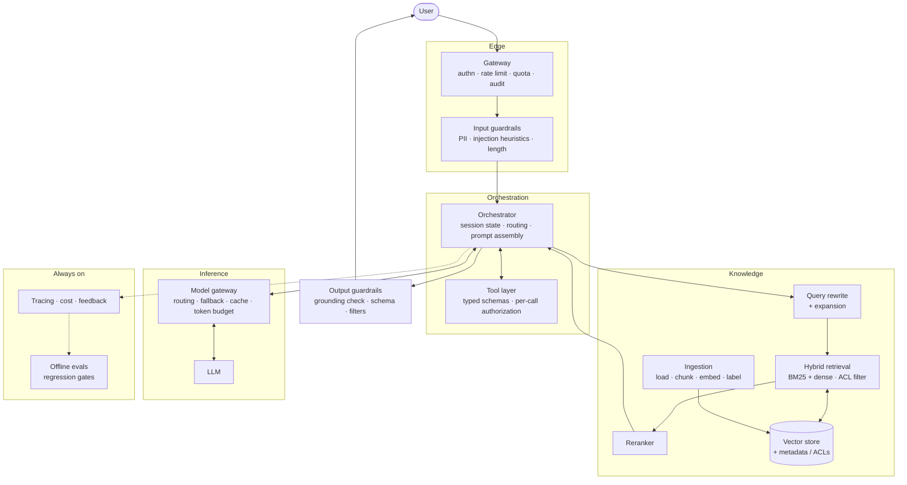

# Problem Statements 1.4, 1.5, 2 and 3

Mohd Mudabbir Arafat · [github.com/Mudabbirarafat](https://github.com/Mudabbirarafat)

---

# Problem Statement 1 — the two links

### 1.4 The most complex Python I have written

**[github.com/Mudabbirarafat/scholarly](https://github.com/Mudabbirarafat/scholarly)**
· live at [scholarly-jet.vercel.app](https://scholarly-jet.vercel.app)

Semantic search over arXiv papers: an ingestion pipeline that embeds a large
corpus under a fixed memory budget, a hybrid retriever, and — the part I would
actually point at — **a retrieval evaluation that runs in CI and fails the
build when quality regresses.**

That is the complexity worth claiming. Anyone can wire an embedding model to a
vector store and get plausible-looking results; the hard part is being able to
say whether a change made retrieval *better*, in a number, before it ships.
The eval set, the metrics (recall@k and MRR over a held-out set of queries
with known-relevant papers), and the threshold that gates the pipeline are the
difference between a demo and something I can change without fear.

The second-hardest part was unglamorous: the whole pipeline has to run inside
a free tier's memory ceiling, which turns "embed the corpus" into real
arithmetic about batch sizes, streaming, and what is allowed to be resident at
once.

### 1.5 The most complex database code I have written

**[github.com/Mudabbirarafat/depwatch](https://github.com/Mudabbirarafat/depwatch)**
· live at [depwatch-2oj2.onrender.com](https://depwatch-2oj2.onrender.com)

Dependency health and supply-chain risk as a scheduled pipeline, over
Postgres. The database work in it:

- **Versioned schema with migrations**, plus a test that fails if the models
  and the migrations have drifted apart. A migration you forgot to generate is
  a deploy that works on your laptop and breaks in production.
- **Idempotent upserts on natural keys**, because the refresh runs on a
  schedule and a pipeline that doubles its rows on a retry is worse than one
  that fails.
- **Quarantine instead of discard.** Records that fail validation are stored
  with the reason and the original payload. The npm registry and the OSV
  advisory database disagree about how to name the same package, and a
  scanner that silently fails to match one reports "no advisories" for
  something it never checked — the dangerous failure here is quiet, not loud.
- **Per-run metadata and freshness gates**, so "when was this last true" is a
  column rather than a guess, and a breached gate fails the run rather than
  publishing stale advisory data.

The same shape is in this assignment's `src/common/db.py`, at a size you can
read in one sitting.

---

# Problem Statement 2

## 2.1 Self-assessment

> **A** — can code independently · **B** — can code under supervision ·
> **C** — little or no understanding

| Area | Rating | What that is based on |
|---|---|---|
| **LLM** | **A** | RAG end to end in `scholarly`, including chunking, embedding, hybrid retrieval, reranking and an offline eval that gates CI. Two MCP servers in production at Joblet. I can take an LLM feature from "we want this" to "it is deployed and I can prove it got better". |
| **AI** (applied AI systems) | **A** | Reading this as the systems discipline — putting models behind APIs, evaluating them, and operating them — which is what I actually do. If it is meant as classical AI (search, planning, constraint solving) I am a **B**. |
| **ML** | **B** | Comfortable with the lifecycle — features, splits, leakage, class imbalance, and why accuracy is usually the wrong metric — and I have used scikit-learn for real problems. I have not owned a trained model in production, so B is the honest answer. |
| **Deep Learning** | **B** | I can read a PyTorch training loop, follow a paper's architecture, and fine-tune an existing model. I have not trained a network from scratch at a scale where the hard parts bite. |

Four A's would be easy to type and hard to defend. I would rather be the
candidate whose B is worth as much as the A, because both are true.

## 2.2 Architecture of an LLM-based chatbot

A chatbot is not a model with a text box. The model is one component, and it
is the only one that cannot be trusted, tested deterministically, or made to
behave by asking it nicely. The architecture exists to put reliable things
around an unreliable one.

### The components, and what breaks without each

| Layer | What it does | What breaks if you skip it |
|---|---|---|
| **Gateway** | Authenticates the user, enforces rate limits and spend quotas, writes the audit trail. | Your bill is now a stranger's decision, and you cannot answer "who asked what" after an incident. |
| **Ingestion & indexing** | Loads source documents, chunks them, embeds them, and — critically — attaches the **metadata that carries the source's access rules**. | Retrieval is only as good as chunking, and ACLs bolted on afterwards are ACLs that do not exist. |
| **Retrieval** | Query rewriting (resolving "what about the second one?" into a standalone query), hybrid BM25 + dense search, reranking, context assembly within a token budget. | Pure dense retrieval misses exact identifiers — error codes, CVE numbers, product names — which is precisely what people search for. |
| **Orchestration** | Session state, routing (does this need retrieval at all?), prompt assembly, the tool-calling loop with a step ceiling. | Unbounded agent loops, and a prompt nobody can reconstruct when it misbehaves. |
| **Tool layer** | Typed schemas for anything the model can *do*, each with its own authorization check. | See below — this is where a chatbot becomes a breach rather than an embarrassment. |
| **Model gateway** | Model choice and fallback, streaming, caching, token accounting. | One provider's outage is your outage, and cost is invisible until the invoice. |
| **Guardrails** | Input: length, PII, injection heuristics. Output: schema validation, grounding/citation checks, filters. | Nothing stands between the model's worst day and your user. |
| **Evaluation & observability** | Traces, cost per conversation, captured feedback, an offline eval set, regression gates in CI. | You cannot tell whether yesterday's prompt change helped. Every subsequent change is a guess. |

### The three things I would say in the room

**1. The model is not a security boundary.** A system prompt is not an access
control list. "Only show the user documents they own" is a *request*, and the
model complies at some rate below 100%. Authorization belongs in the retrieval
filter and at the tool call site, enforced deterministically in code that runs
whether or not the model cooperates. If the only thing stopping a user reading
another tenant's data is a sentence in the prompt, there is no control there.

**2. Retrieved content is untrusted input.** This is the part most RAG
diagrams get wrong. Indirect prompt injection means the attacker does not talk
to your bot — they put instructions in a document your bot will later retrieve:
a support ticket, a scraped page, a PDF, a code comment. The model cannot
reliably tell retrieved text from your instructions, because to the model they
are the same tokens. Mitigation is structural, not textual: keep retrieved
content in a clearly delimited channel, strip or neutralise instruction-shaped
content at ingestion, and — above all — never let retrieved text raise the
privileges of the request that retrieved it.

**3. Every tool call is a confused-deputy risk.** The moment the chatbot can
*act* — send mail, query a database, call an internal API — it is a deputy
holding the service's credentials and taking instructions from text. The rules
that follow: tools run with the **end user's** authority, not the service
account's; every call is authorized server-side at the call site, because the
schema the model saw is a suggestion; anything irreversible or outward-facing
needs a human; and all of it is logged with the conversation that caused it.

Those three are also why I would build the evaluation harness on day one
rather than at the end. Guardrails are claims, and a claim nobody measures is
decoration.

## 2.3 Vector databases

### What they are

Text, images and code can be mapped to fixed-length vectors by an embedding
model, arranged so that **semantic similarity becomes geometric closeness** —
"how do I rotate a key" lands near a document about credential rotation even
with no word in common. A vector database stores those vectors with their
metadata and answers "which k vectors are nearest to this one" quickly.

The reason it is a separate kind of database is that doing it exactly is
hopeless at scale. Exact k-nearest-neighbour search is O(N·d): eight million
768-dimension vectors is roughly six billion multiply-adds per query. So these
systems use **approximate** nearest neighbour indexes that trade a little
recall for orders of magnitude of speed.

| Index | Idea | Trade |
|---|---|---|
| **Flat** | Compare against everything. | Perfect recall, linear cost. Correct below ~50k vectors, and worth remembering before reaching for anything else. |
| **IVF** | Cluster the space; search only the nearest cells. | Fast, but a vector near a cell boundary can be missed. |
| **HNSW** | A multi-layer "small world" graph — long hops on sparse upper layers, short hops as you descend. | The usual default: excellent recall-per-millisecond, at the cost of holding the graph in RAM. |
| **PQ / scalar quantization** | Compress each vector into a few bytes. | 4–32× less memory for a measurable recall loss. The lever you pull when the index outgrows the machine. |
| **DiskANN** | Graph index designed to live on SSD. | Billions of vectors per node; more latency per query. |

Two practical points that cost people weeks:

- **The distance metric must match how the embedding model was trained.**
  Cosine for a model trained with cosine; using L2 instead gives results that
  look plausible and are quietly wrong, which is the worst kind of wrong.
- **Re-embedding is a migration.** Vectors from two different models are not
  comparable. Changing the embedding model means rebuilding the whole index,
  so version it from the first day rather than discovering it on the day you
  want to upgrade.

### A problem to choose for

> **An on-call assistant for a security operations team.** It answers
> questions over ~8 million chunks drawn from internal runbooks, past incident
> tickets, vendor advisories and our own detection rules. It is multi-tenant:
> each customer's incident history is visible only to people on that account,
> and some runbooks are restricted further by team. ~50 queries/second at
> peak, p95 under 150 ms for retrieval, new documents land every 15 minutes
> and must be searchable within the hour. Three engineers run it alongside
> other work. **The corpus is customer security data, so it cannot leave our
> VPC.**

Those constraints do most of the choosing.

| | pgvector | **Qdrant** | Milvus | Pinecone | FAISS |
|---|---|---|---|---|---|
| Deployment | Extension on Postgres you already run | Single Rust binary; self-host or managed | Distributed; several moving parts | Managed only | A library, not a service |
| Data residency | Yours | Yours | Yours | **Theirs** | Yours |
| Filtered search | SQL `WHERE`; planner may post-filter or fall back to a scan | **Filter applied inside the graph traversal** | Partitions + scalar filters | Metadata filters | None — you build it |
| Comfortable scale | Up to a few million | 1M–100M+ | 100M+ | Any | In-process only |
| Ops burden | ~zero if you already run Postgres | Low | High | Zero | None, but no persistence or replication |
| Live updates | Transactional | Native | Native | Native | Rebuild |

**I would choose Qdrant.**

1. **Data residency rules out managed-only.** The corpus is customer security
   data. Pinecone is a good product and not an option here, and that is a
   contractual constraint, not a technical preference.
2. **Filtering is a correctness property, not a feature** — the next section
   is entirely about this, and it is the reason Qdrant beats pgvector for
   *this* problem rather than a general claim that it is better.
3. **8M vectors fit on one machine.** At 768 dimensions, float32 is
   `8e6 × 768 × 4 ≈ 24.6 GB`, which is awkward. With scalar quantization to
   int8 it is `≈ 6.1 GB`, plus roughly 1 GB for the HNSW graph at M=16 — about
   **7 GB of RAM**, comfortable on one node with a replica for failover. That
   is squarely the range where Milvus's distributed architecture (etcd, object
   storage, separate query/data/index roles) is operational cost bought for
   nothing. Three part-time engineers is a real constraint.
4. **Live updates without a rebuild**, which the 15-minute ingest needs.

**When I would choose differently, which matters as much:**

- **Under ~1M vectors, and the data is already in Postgres → pgvector.** One
  fewer system to run, back up, monitor and secure, plus joins and
  transactions against the rest of the data. The right answer to a retrieval
  problem is frequently "the database you already have". I would only add a
  dedicated vector store once I could show it was needed.
- **Above ~500M vectors → Milvus or DiskANN**, where the distributed
  architecture is paying for itself.
- **Static corpus, batch, no service → FAISS.** No server at all.
- **If lexical matching dominated** — exact error codes, CVE identifiers,
  hostnames — I would reach for OpenSearch and its hybrid scoring before any
  pure vector store, because dense retrieval is weakest at exactly the strings
  people paste from a terminal.

### The part that makes this a security question

**Pre-filtering vs post-filtering is not a performance detail.**

Take a tenant with 200 of the 8 million chunks. The naive implementation
retrieves the top 50 by similarity across everything, then removes what the
user may not see.

> Those 200 chunks are 0.0025% of the corpus. The top 50 global matches will
> almost certainly contain **none** of them. The user asks a question their own
> incident history answers perfectly and is told there is nothing — while the
> system did read other tenants' documents to reach that conclusion.

It is simultaneously a quality bug and an information leak: result counts and
response latency both vary with how much *other* tenants' data matched, which
is a side channel you did not intend to build. Qdrant's filterable HNSW keeps
the constraint inside the graph traversal, so the search is over that tenant's
200 chunks from the start. pgvector can express the same query, but whether it
pre-filters, post-filters or abandons the index for a sequential scan is up to
the planner — and "it depends on the query plan" is not a sentence I want in a
tenancy boundary.

Two more that belong in the same conversation:

- **Embeddings are not anonymisation.** Embedding-inversion research recovers
  substantial portions of source text from vectors alone. A vector store built
  from confidential documents inherits their classification — same encryption,
  same access control, same retention and deletion obligations. "It's only
  numbers" is wrong.
- **Deletion must reach the index.** When a customer leaves, or a document is
  revoked, the vector has to go too — and with many ANN indexes a delete is a
  tombstone until the next compaction. If your deletion story stops at the
  source system, your retrieval still answers from the deleted document.

---

# Problem Statement 3

**[github.com/Mudabbirarafat/depwatch](https://github.com/Mudabbirarafat/depwatch)**
— dependency health and supply-chain risk as a pipeline.
Live at [depwatch-2oj2.onrender.com](https://depwatch-2oj2.onrender.com).

Why it's hard:

1. **The sources disagree about identity.** The npm registry and the OSV
   advisory database name the same package differently, and a scanner that
   quietly fails to match one reports "no advisories" for something it never
   actually checked — the dangerous failure here is silent, not loud, so
   malformed records are quarantined with their reason and payload rather than
   dropped.
2. **"Unmaintained" is a judgement, not a fact.** Every score has to carry its
   evidence and its reasoning, because a risk score nobody can argue with is a
   risk score nobody trusts.
3. **It has to stay true after I stop looking at it.** The refresh runs on a
   schedule behind freshness and quality gates, and a breached gate fails the
   run rather than publishing stale advisory data.
