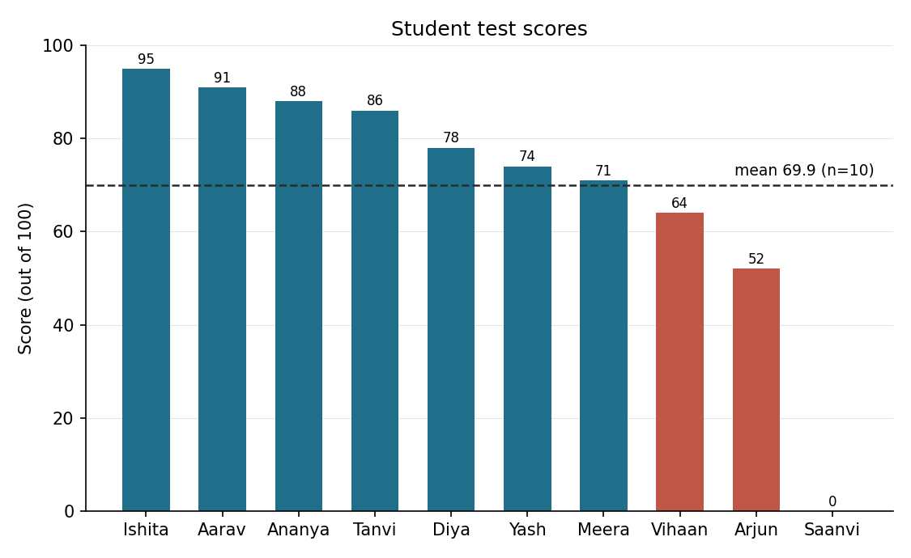

# AccuKnox assignment — Mohd Mudabbir Arafat

Problem Statement 1 is in `src/`. Problem Statements 2 and 3 are in
[ANSWERS.md](ANSWERS.md).

## Running it

```bash
pip install -r requirements.txt

python -m src.task1_books --query "security engineering" --limit 8
python -m src.task2_scores --offline data/scores.json
python -m src.task3_users  --csv data/users.csv --export output/users.csv

python -m pytest -q        # 90 tests, no network needed
```

Python 3.10 or newer. No API keys, no accounts, no `.env` — every endpoint
used here is public, which is deliberate: there is nothing in this repository
to leak, and anyone can clone it and get the same output I did.

---

## The thing these three tasks are actually testing

Each task is about ten lines of code if you only have to make it work once,
on your own machine, with input you chose. All three are a different size
once the input is somebody else's and the script has to run again next
Tuesday without you watching.

So the shape of all three is the same — **fetch → validate → quarantine →
upsert → report** — and the decisions worth defending are these:

| Decision | Why it is not the obvious thing |
|---|---|
| Every query parameterised | Not because these inputs are hostile, but because "is this safe?" should be answerable by grepping for `%` and finding nothing, not by reading every call site and judging each one. |
| Writes are upserts on a natural key | An import you cannot safely re-run is an import somebody has to supervise. Running all three twice leaves the same rows as running them once; the tests assert it. |
| Bad rows are quarantined, not dropped | A dropped row is a silent failure. The import reports success, the data is gone, and nobody finds out until someone asks where a user went. `rejected_rows` keeps the line number, the reason and the original text. |
| Validation returns a reason, not a bool | `(None, "publication year 3099 is outside 1450-2027")` is something you can put in a table and hand to a human. `False` is not. |
| HTTP has a deadline and a size cap | `requests.get(url).json()` has neither. A server that accepts a connection and goes quiet hangs the process forever; a 2 GB response is a one-line denial of service against whatever is importing it. |
| Redirects are followed by hand | So the scheme can be checked at **every** hop. An `https://` URL that redirects to `file:///etc/passwd` or `http://169.254.169.254/` is the classic SSRF shape, and `requests` follows it by default. |
| CSV formula injection is fixed at export | A cell holding `=cmd\|'/c calc'!A0` is inert in SQLite — it is a string, in a parameterised query. It becomes a problem when it is written back to a CSV and opened in Excel (CWE-1236), so that is where it is escaped. |

That last row is the one I would most want to talk about, because the instinct
is to reject the row on input, and that is the wrong fix in the wrong place:
it destroys real data to protect a program this script does not run.

---

## Task 1 — API → SQLite → display

`src/task1_books.py`. Source: Open Library's search API (no key).

```
TITLE                                                         AUTHOR               YEAR
------------------------------------------------------------  -------------------  ----
MCA Microsoft Certified Associate Azure Security Engineer...  Shimon Brathwaite    2022
Violent Python A Cookbook For Hackers Forensic Analysts P...  Tj O'Connor          2012
Physical-Layer Security                                       Matthieu Bloch       2011
Social Engineering                                            Christopher Hadnagy  2011
Software security engineering                                 Julia H. Allen       2008
Software Security Engineering                                 Nancy Mead           2004
Security Engineering                                          Ross J. Anderson     2001
Software Engineering                                          Roger S. Pressman    1982

8 fetched, 8 stored, 0 rejected.
```

The display reads back **out of the database** rather than printing what was
just fetched. Printing the fetch would pass this task while a storage bug went
unnoticed, which rather defeats the point of the task.

Open Library genuinely returns records with no author, an empty title, and
publication years in the future, so `tests/fixtures/openlibrary_search.json`
holds seven records of which four are bad in four different ways:

```
7 fetched, 3 stored, 4 rejected.
```

Two of the four are worth naming. A year sent as the string `"1995"` is
truthy, is not `None`, and survives `int(year)` — but sorts and compares as
text. And `isinstance(True, int)` is `True` in Python, so a boolean year
sails through an unguarded `int` check and is stored as the year 1.

**The natural key is `(title, author, publication_year)` and all three are
`NOT NULL`, which is load-bearing.** In SQLite — and in the SQL standard —
`NULL` is not equal to `NULL`, so a `UNIQUE` index containing a nullable
column does not constrain the rows where it is null. Allow year-less books and
every re-run inserts another copy of every one of them.

## Task 2 — scores → average → bar chart

`src/task2_scores.py`.

```
  rejected record 6: S-1007: score is '83', not a number
  rejected record 8: S-1009: score 105.0 is outside 0.0-100.0
12 fetched, 10 stored, 2 rejected.
Average score: 69.90 over 10 students.
Highest: Ishita Bose (95)
Lowest:  Saanvi Rao (0)
Chart written to output/scores.png
```



**On the API.** There is no stable public "student test scores" endpoint. The
ones that come up in search either return random data on each call or have
stopped existing, and both make a chart that cannot be reproduced. So the
scores are a JSON document in this repository served over HTTPS by GitHub raw,
fetched through the same capped and scheme-checked fetcher as task 1, with
`--offline` reading the identical file from disk. It is a real HTTP request to
a real remote URL, and the numbers do not move under the chart between runs.
I would rather explain that choice than ship a chart I cannot reproduce.

**The averaging is the part that needs care**, because an average is one
number that gets quoted away from its context:

- `average()` returns `(mean, count)`, never just the mean. "Average 84" over
  3 of 12 students is a different claim from "average 84", and a caller given
  only the number cannot tell them apart — it will print it either way.
- A score of **0 is a real score**. The bug this guards against is `if not
  score:`, which treats a zero as missing and quietly raises the class
  average. Saanvi Rao's zero-height bar in the chart is that test, drawn.
- `sum([]) / len([])` is a `ZeroDivisionError`, and an empty list is exactly
  what a wholly failed import produces. It is checked, not caught.

The chart's y axis starts at 0 — a bar chart starting at 60 makes a four-mark
gap look like a chasm, which is the most common way a chart lies with true
numbers. The mean is a line across the bars rather than a thirteenth bar,
because it is a different kind of quantity. Bars below it are a second colour,
because that is the one comparison anyone wants and colour answers it faster
than reading ten numbers off an axis.

## Task 3 — CSV → SQLite

`src/task3_users.py`. `data/users.csv` is deliberately messy, and every bad
row in it is a bug this script would have had if it were the four-line version
of itself:

```
  note: line 8 starts with a formula character; it will be escaped on export
12 rows read, 7 inserted or updated, 5 rejected.
users table now holds 6 row(s).

Rejected:
  line 5: domain has no dot
  line 6: missing name
  line 7: email contains whitespace
  line 10: row has more fields than the header
  line 12: email has 2 @ signs, expected exactly 1
```

Seven rows pass validation and six people land, because Alice is in the file
twice — once as `Alice.Mathew@Example.com` and once as
`alice.mathew@example.com`. **Email is the identity, so it is normalised
before it becomes the key.** A `UNIQUE` index on the raw string would let both
in, after which every count of users in the system is wrong.

The email check is deliberately **not** an RFC 5322 regex. A correct one is
several hundred characters long, accepts addresses no mail server will deliver
to, and the well-known ones are vulnerable to catastrophic backtracking —
which turns a validation function into a denial of service. The only real test
of an address is sending mail to it. This rejects what is certainly not an
address, cheaply, in linear time.

Line numbers in the quarantine are the **file's own**, header included, so a
person can open the CSV and go straight to the row.

---

## Tests

```
$ python -m pytest -q
90 passed in 3.4s
```

`tests/test_http.py` runs against a real HTTP server on a loopback port rather
than mocks. Mocking `requests.get` proves the code calls the function I wrote,
which was never in doubt; what is in doubt is whether the size cap actually
stops a 50 kB body and whether a redirect can walk off `http` onto `file://`.
Those are only answered by something on the other end of a socket.

No test touches the internet, so CI cannot go red because a third party is
having a bad afternoon.

## Layout

```
src/common/db.py        connection pragmas, schema, quarantine, run log
src/common/http.py      the only place this project talks to the network
src/common/console.py   UTF-8 stdout, so a non-ASCII title cannot kill a run
src/task1_books.py      API -> SQLite -> table
src/task2_scores.py     API -> average -> bar chart
src/task3_users.py      CSV -> SQLite, with a spreadsheet-safe export
data/                   the scores document and the deliberately messy CSV
tests/                  90 tests, no network
```

`src/common/console.py` exists because of a real failure on the first live
run: a returned title contained a character this Windows console's code page
cannot encode, and Python's response to that is not a mangled character but
`UnicodeEncodeError`, raised from `print`, *after* the rows were committed.
The data is fine and the program dies anyway, on the last line, on a machine
that is not mine. That is the whole of "it worked when I ran it", and it costs
four lines to remove.
